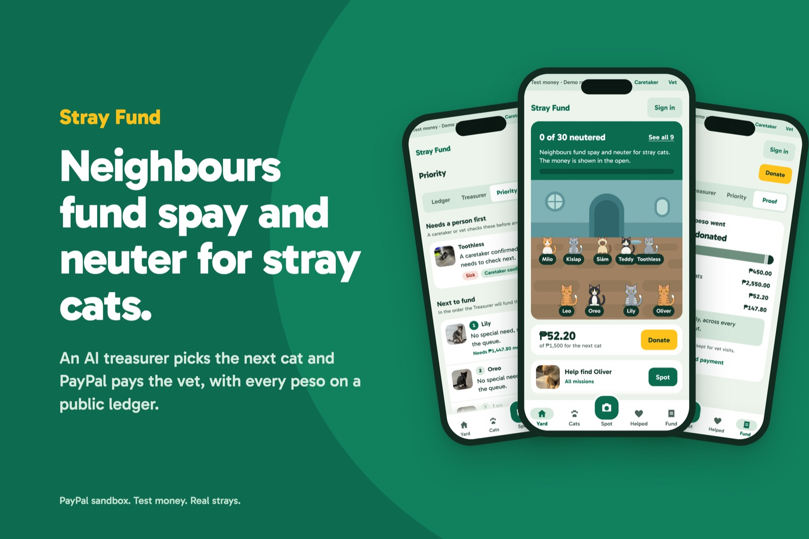
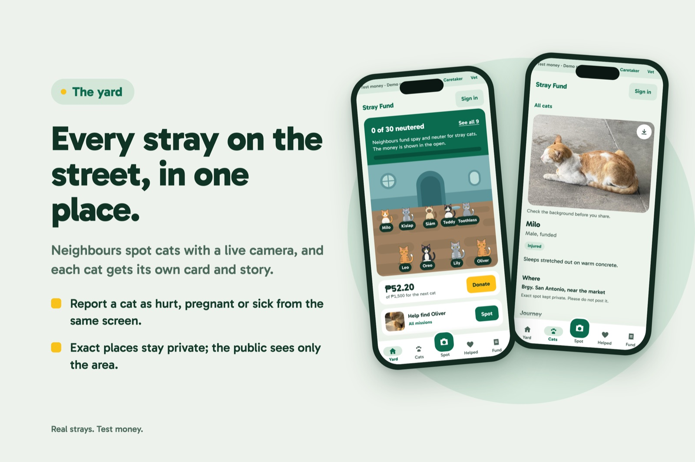
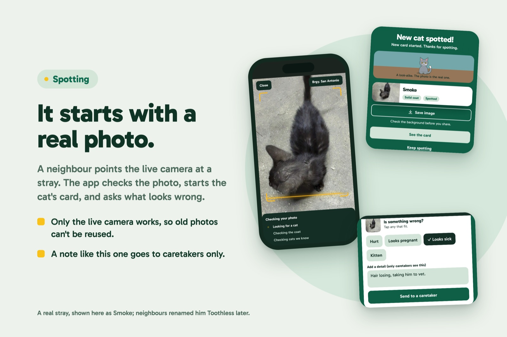
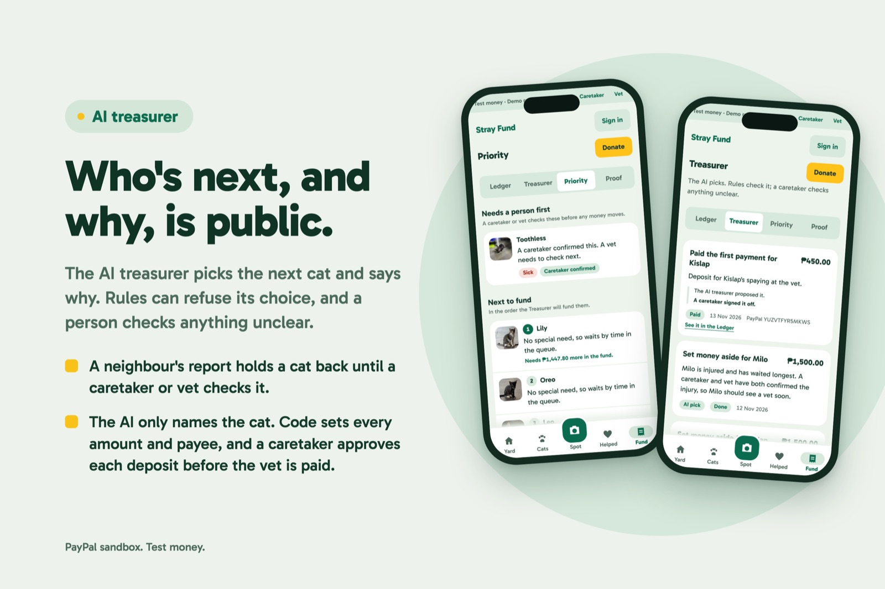
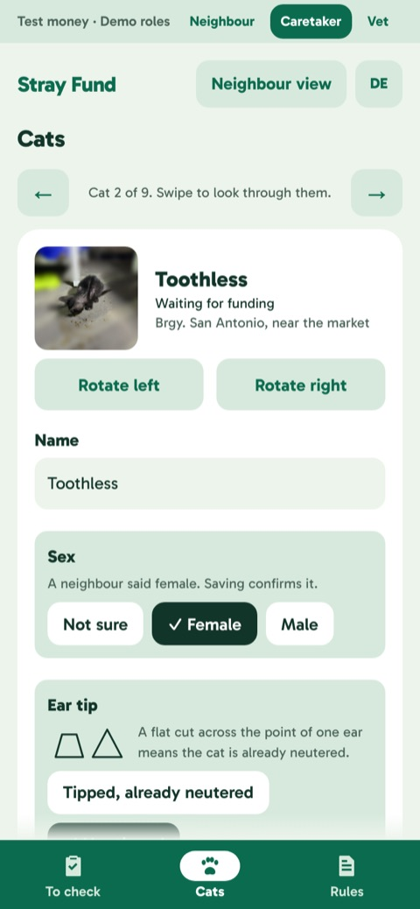
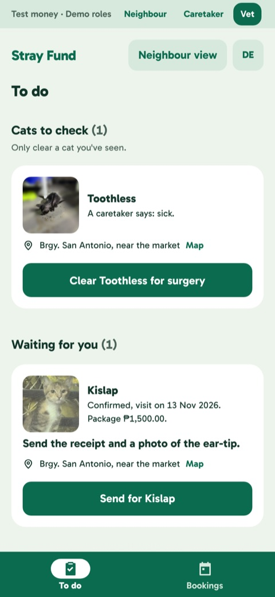
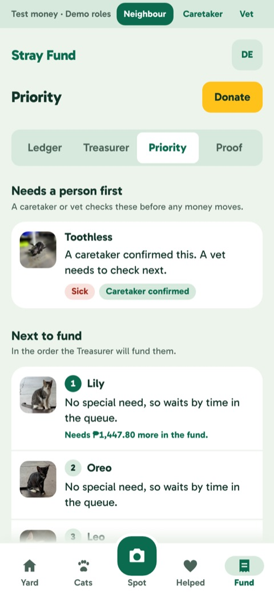
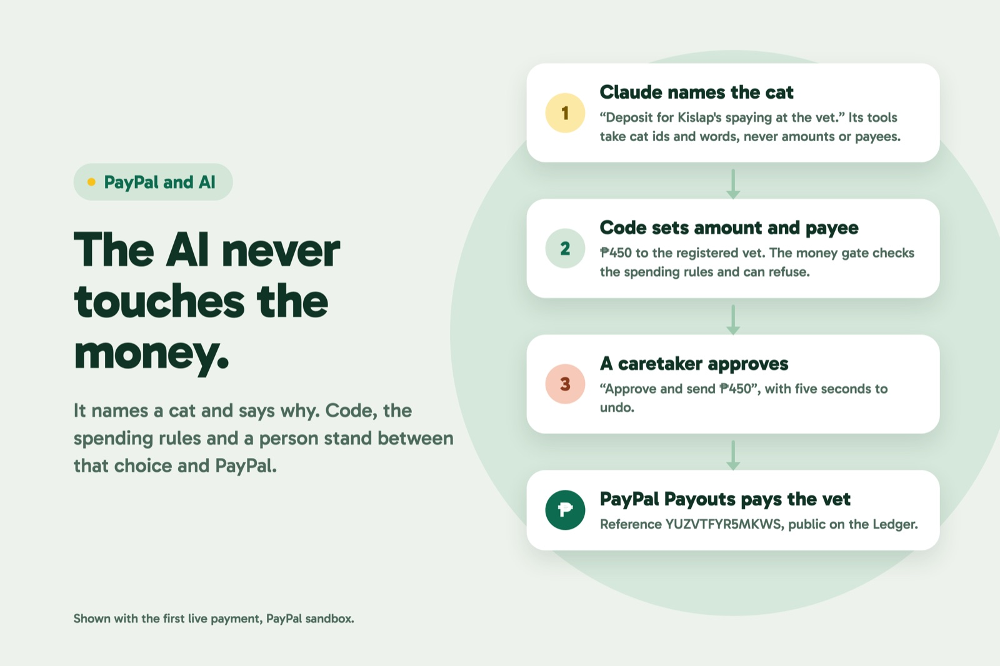
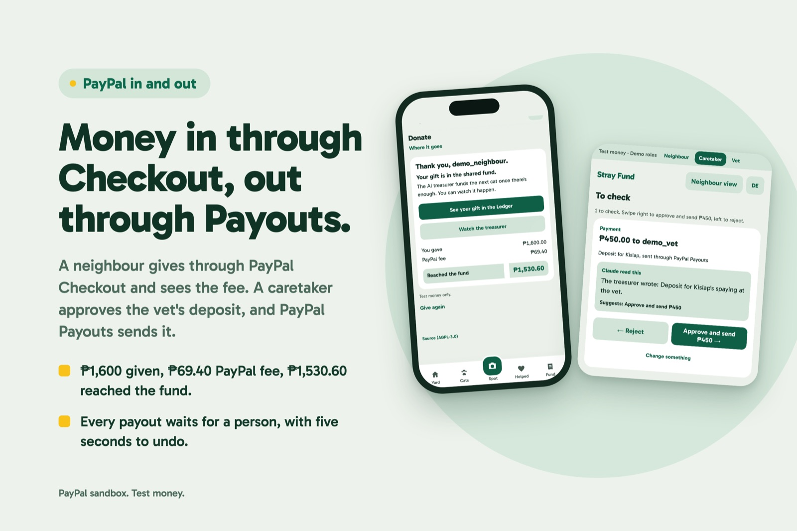

# Stray Fund

A shared fund for one neighbourhood's stray cats. Neighbours spot cats and give through PayPal. An AI treasurer picks which cat gets spayed or neutered next and says why in public. A person approves every payment before PayPal Payouts sends it to the vet, and every peso shows on a ledger anyone can check.

Built for the PayPal AI Hackathon, on PayPal sandbox money only. Try it at https://stray-fund.onrender.com, or follow the [testing guide](testing-guide.pdf).

<p align="center"></p>

## Why it exists

Strays multiply when people feed them but nobody neuters them. Neighbours would chip in, but they can't see where the money goes, and help tends to reach the cutest cat instead of the pregnant or hurt one. Stray Fund keeps the whole trail in public: who reported a cat, who checked it, why the treasurer chose it, and the PayPal reference for every payment.

## How it works

1. A neighbour spots a cat with the phone's live camera. Old photos can't be uploaded.
2. They can report it as hurt, pregnant, sick or a kitten, with a note only caretakers read. A report holds the cat back from funding until a person checks it.
3. Neighbours donate through PayPal Checkout into one shared fund. PayPal's fee is counted, so the fund only holds what arrived.
4. A caretaker confirms or dismisses each report. A confirmed report keeps the cat on hold until a vet clears it for surgery.
5. The AI treasurer reads the waiting cats, the checked reports and the fund, picks the next cat and writes a public reason.
6. Rules check the payment, a caretaker approves the deposit, and PayPal Payouts sends it to the partner vet.
7. After surgery the vet sends a receipt and an ear-tip photo. The AI reads the receipt, code compares it with the booking, and a caretaker checks the photo before the balance is paid.

People decide ear-tips, because the AI got them wrong on real photos. Neighbours answer Yes, No or Not sure, two different people saying No queue the cat, and a caretaker settles any disagreement.

<p align="center">
  
  
</p>

Four public pages show the money. Priority lists who's next and why, Treasurer lists every AI decision with its reason, Ledger lists every donation and payout with its PayPal reference, and Proof shows the totals adding up exactly. Each cat's page tells its story as one timeline.

<p align="center">
  
  
</p>

## The desks

Caretakers and vets work on their own screens, on a green bar, apart from the neighbour app. The caretaker's To check is a stack of cards. Each card says what Claude read and which way it leans; a swipe right or left decides, and nothing is sent for 5 seconds, so Undo can take it back. Cats is a profile per cat with one Save, where a confirmed or dismissed report can be reopened if someone got it wrong. The vet gets To do and Bookings, with each cat's photo. A vet's clearance and money PayPal has sent can't be undone.

<p align="center">
  
  
  
</p>

## How the AI is kept away from the money

The AI proposes, rules check, and a person approves.

<p align="center"></p>

- The treasurer calls a few tools that take cat ids and words ([src/server/agent/tools.ts](src/server/agent/tools.ts)). No tool takes an amount or a PayPal address; code supplies both.
- Every payout goes through one function, the money gate ([src/server/moneyGate.ts](src/server/moneyGate.ts)). It takes a lock, checks the guardrails ([src/server/guardrails.ts](src/server/guardrails.ts)), writes the action down, and only then calls PayPal. The guardrails cover allow-listed payees, caps per cat and per day, a verified receipt, a confirmed ear-tip and duplicate payouts.
- A caretaker approves every deposit, and a balance over the approval threshold waits for one too.
- A neighbour's report can hold a cat but never reorder the list. To pass over a cat, the treasurer has to cite a report a person checked, and its reason has to name the cats it passed over. Code enforces both, though it can't check that what the reason says is true.
- Notes, receipts and photos are data. Text inside an image can't authorise anything, and a reason that repeats four words from a note is swapped for a fixed line before it goes public.
- A daily cap limits AI calls.

## PayPal

Checkout (Orders v2) takes donations and records each capture's net amount after fees. Payouts pays the vet a deposit and later a balance, and each payout reuses one `sender_batch_id`, so a retry can't pay twice. Webhooks settle captures and payouts. The treasurer is also offered the PayPal agent toolkit's read-only `get_order`, though it hasn't called it through the app yet. The code is in [src/server/paypal/](src/server/paypal/).

On the live sandbox site on Nov 13, a caretaker's approval sent the first vet deposit: ₱450 for Kislap, PayPal reference `YUZVTFYR5MKWS`, reported succeeded.

<p align="center"></p>

## AI

Claude is the treasurer. On the live site it runs as Claude Haiku 4.5 on Amazon Bedrock, where it funded its first cat on Nov 12 after sandbox donations. Locally it can run through the Claude command line instead (`AI_PROVIDER=claude-cli`, local only; production refuses it). Claude also reads vet receipts, and on the judges' path it checks spot photos and marks regions to blur.

Ultralytics YOLO11n-seg cuts the cat out of a photo so only the cat stays sharp, on the phone with onnxruntime-web or in the worker. COCO-SSD runs in the browser for the "cat found" hint, so no photo leaves the phone for that.

## Architecture

```
Browser (Next.js app, camera, PayPal buttons, AG Grid ledger)
   |
Next.js route handlers  <--- PayPal webhooks
   |
Postgres (source of truth)  <-->  Worker: the AI treasurer loop
   |                               money gate: guardrails -> action row -> PayPal
S3: private originals, public scrubbed copies
```

Next.js and TypeScript, Postgres with Drizzle, and a separate worker process, hosted on Render. The model is never in the path of a page load.

## Run it locally

You need Node 22 and Postgres 17.

1. Make two databases, `strayfund_dev` and `strayfund_test`.
2. `cp .env.example .env.local` and fill it in. `.env.example` explains every variable, and `.env*` is ignored by git.
3. `npm install`, then `npm run db:migrate`.
4. `SEED_CONFIRM=yes npm run seed` loads seven real strays with their own photos and no money. It empties the dev database first and refuses unless `DEMO_MODE=true` and PayPal isn't live.
5. `npm run dev`, and `npm run worker` in a second terminal.
6. Open http://localhost:3000. The strip at the top switches between Neighbour, Caretaker and Vet.

PayPal sandbox needs `PAYPAL_CLIENT_ID`, `PAYPAL_CLIENT_SECRET` and a sandbox buyer account. The seed holds Milo back with one sample hurt report, so the quickest tour is: confirm Milo's report as Caretaker, clear him as Vet, donate ₱1,600 (enough to cover the ₱1,500 care package after PayPal's fee), then open Priority and Treasurer.

## Tests

`npm test` runs 1,947 tests against a real Postgres in `TEST_DATABASE_URL`. `npm run lint` and `npx tsc --noEmit` check the rest. `npm run e2e` walks the whole story in a browser against fakes, from a hurt report to a funded cat, and checks that no note or coordinates reach a public page; it needs a scratch database in `E2E_DATABASE_URL`. `npx tsx scripts/check-public-leaks.ts` loads the public pages and the staff desks as each role, with a note holding a phone number, a street and a name.

## Deploy

[docs/deploy.md](docs/deploy.md) covers the Render Blueprint (`render.yaml`), S3, an IAM role through Render's OIDC sign-in with no AWS keys, the PayPal webhook, and the "Before real money" checklist. The live site was deployed by following it. Its Postgres refuses outside connections, and an AWS budget of $5 a month emails at 80% and 100%.

On the live site these have run for real: spot photos stored in S3 from a phone camera over HTTPS, a donation captured through the screen, the treasurer on Bedrock funding a cat and asking a caretaker to check a report, and the ₱450 Payouts deposit.

Two switches matter for a public demo. `JUDGE_GATE=true` with `JUDGE_PASSCODE` limits the staff roles, donating, reports and votes to judges, who open `/judge?code=…` once; everyone else can browse and spot as a Neighbour, with a daily limit and no AI. The live site runs with the gate on. `DEMO_HIDE_PRIVATE=true` hides original photos, receipt text, the treasurer's reasons and the vets' emails on the demo desks. Exact places stay hidden in demo mode either way, because they're real GPS points.

## Known limits

Read this before trusting it with anything real.

- There's no real sign-in. The roles, volunteer ID tags and the vet register are simulated, so anyone in the demo can confirm a report or clear a cat.
- The treasurer's weighing was tried on a handful of cases, three runs each, on the local `claude -p` route and not yet on Bedrock. It sometimes funded nobody, and in 8 of 45 valid runs it said a tool failed when it never called one.
- The filter on the treasurer's public reasons is simple. It misses a name or place written in lowercase and numbers spelled out in words.
- On the judges' path a spot photo goes public with no person looking. Everything but the cat is blurred, and a caretaker can hold it back afterwards.
- A vet and a caretaker could collude, a photo could be forged, and the live-camera rule is enforced in the app only.
- The coat rule treats calico and tortoiseshell cats as female, so a wrong call moves a cat up the queue.
- Refunds and chargebacks are handled in code but not proven on real PayPal, and live webhook deliveries haven't been checked end to end.
- Not built yet: adoption fees, foster allowance, monthly sponsors, a map. Merging duplicate cats works only for a duplicate made by a plain photo.

## Licence

AGPL-3.0, see [LICENSE](LICENSE). Dependency and asset licences are in [docs/licences.md](docs/licences.md). The worker finds the cat in a photo with Ultralytics YOLO11n-seg (AGPL-3.0), exported to ONNX at `public/models/cat-seg-v1/yolo11n-seg.onnx`, which is why this repo is AGPL-3.0 rather than MIT.
